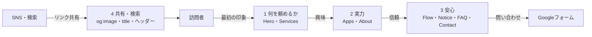
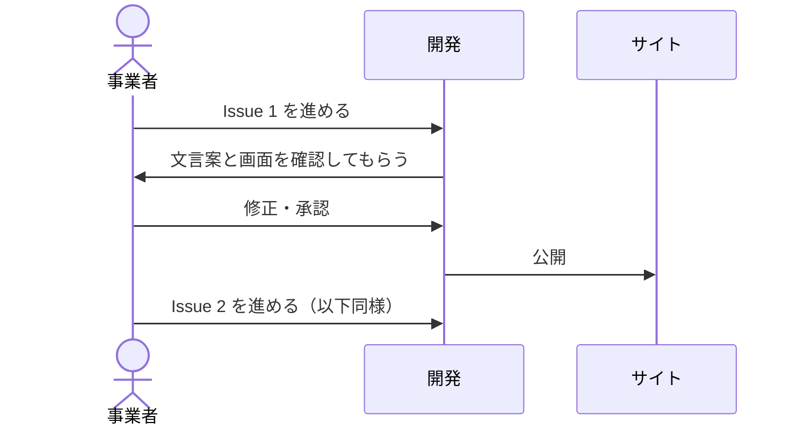
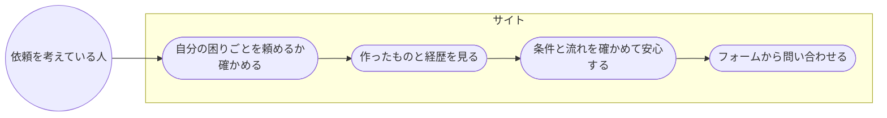
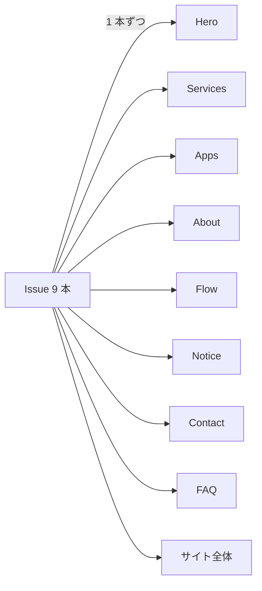
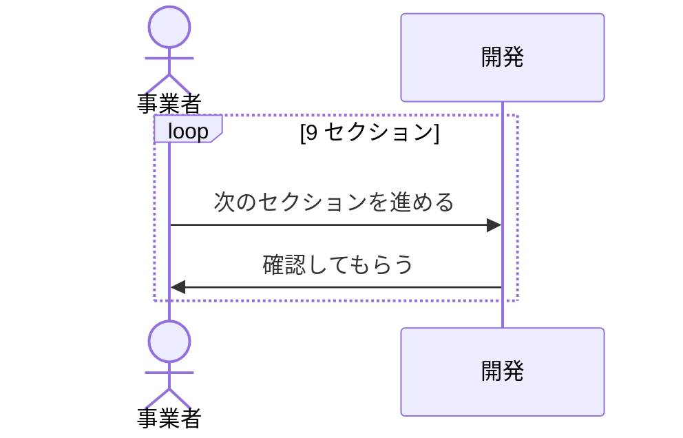
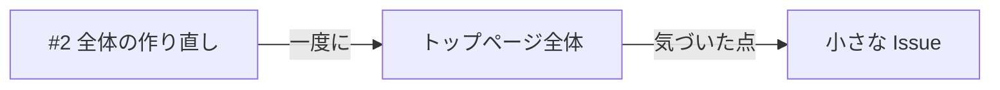
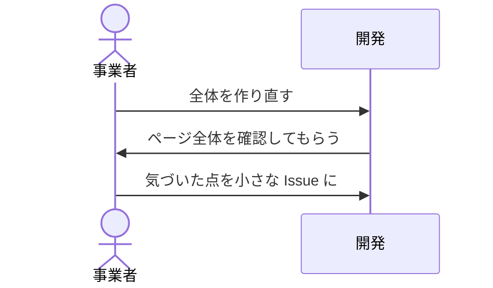

<!-- draft:common:start -->
## 背景

トップページの文面は「何をしている事業か」の説明止まりで、訪れた人が「自分の困りごとを頼めそうだ」と思える材料が足りない。レビューで挙げた大きな問題は 3 つ。

1. 誰の・どんな困りごとを解決するのかが書かれていない
2. 実力を示す材料が少ない（スキル未記載、アプリは公開予定の 1 本だけ）
3. 問い合わせの前で不安が増える並び（「お受けできない依頼」が問い合わせの直前）

## ゴール

問題点ごとに Issue を作り、1 件ずつ解決していく。ここで決めるのは **Issue の分け方と進める順番**。

## 問診で分かった事実（サイトに書いてよいもの）

- ご相談・お見積もりは無料
- 対応できる取引条件: 秘密保持契約（NDA）、成果物の権利の譲渡、小さな依頼や相談だけでも可、納品後の修正（即時対応は除く）
- 実績: RoomCheckPDF は 1 人で企画から公開まで担当。本業でも開発職（現役）
- スキル: C# による医療システムの開発 15 年、Claude や Copilot の業務活用、前職（金融機関）での経験（簿記など）
- GitHub へのリンクは載せない

## 要件

- 金額・個人名・住所・電話番号・本業の勤務先が分かる情報・架空の実績は載せない
- 副業の条件（平日夜と土日祝、返信は 3 日以内）と矛盾する約束は書かない
- 英語ページには依頼を受け付ける内容を書かない
<!-- draft:common:end -->

<!-- draft:A:start -->
## 案A: 訪問者の気持ちの流れで 4 つに分ける（推奨）

#### 確認ページ
- 要約: 「わかる → 信頼できる → 安心して問い合わせる → 人に勧められる」の 4 段階で Issue を 4 本に分け、この順に直す。1 本目は #2 で進める
- 得るもの: 1 本ごとに「訪問者の気持ちが 1 段進む」ので、効果を確かめながら進められる。関係の深いセクション（Flow・Notice・FAQ・Contact など）を同じ Issue で直すため、並び順や言い回しがそろう
- 失うもの: 1 本あたりの変更が数セクションにまたがり、セクション単位で分けるより PR が少し大きくなる

内訳（この順で進める）:
1. **何を頼めるかが伝わる**: Hero のキャッチコピー・リード文・ボタン、Services を「こんなご相談に対応できます」の具体例に（自社アプリは Services から外す）
2. **実力が伝わる**: Apps を開発事例として見せる（スクリーンショット・使った技術・1 人で企画から公開まで）、About にスキルと進め方
3. **安心して問い合わせられる**: Flow に無料相談などを追記、Notice を「こんな方に向いています」から始める形に、FAQ を追加、Contact に書いてほしいことの案内、セクションの並び替え
4. **共有・検索で伝わる**: og:image、トップの title、スマホのヘッダーのお問い合わせボタン

#### データフロー図
見てほしい点: 各 Issue が、訪問者の気持ちの段階に 1 対 1 で対応していること

#### シーケンス図
見てほしい点: 1 本ずつ確認してから次へ進むこと

#### ユースケース図
見てほしい点: 依頼を考えている人が、ページの上から下までで何を確かめられるようになるか

<!-- draft:A:end -->

<!-- draft:B:start -->
## 案B: セクションごとに 1 本ずつ分ける

#### 確認ページ
- 要約: Hero・Services・Apps・About・Flow・Notice・Contact・FAQ（新規）・サイト全体の 9 本に分け、上から順に直す
- 得るもの: 1 本の変更が小さく、レビューしやすい。どこを直したかが分かりやすい
- 失うもの: 本数が多く、終わるまでの往復が増える。Notice と Contact の並び替えや、Services と Apps の役割分担など、セクションをまたぐ直しがどの Issue の担当かがあいまいになり、言い回しもそろいにくい

#### データフロー図
見てほしい点: Issue とセクションが 1 対 1 で、セクションをまたぐ直しの置き場所がないこと

#### シーケンス図
見てほしい点: 往復の回数が 9 回になること

#### ユースケース図
該当なし（訪問者の体験は案A と同じ。違うのは進め方だけ）
<!-- draft:B:end -->

<!-- draft:C:start -->
## 案C: まとめて作り直してから細部を直す

#### 確認ページ
- 要約: #2 でトップページ全体の文言と並び順を一度に作り直す。そのあと気になった点を小さな Issue で直す
- 得るもの: 全体の流れと言い回しが一度でそろう。公開までが最短
- 失うもの: 1 本の PR がとても大きく、確認に時間がかかる。どの変更が効いたのかが分かりにくい。「問題点ごとに Issue を作る」という依頼の形から外れる

#### データフロー図
見てほしい点: 全セクションが 1 本の Issue に集まること

#### シーケンス図
見てほしい点: 確認が 1 回に集中すること

#### ユースケース図
該当なし（訪問者の体験は案A と同じ。違うのは進め方だけ）
<!-- draft:C:end -->

<!-- draft:questions:start -->
### Q1: 経歴の「医療システム」はどこまで書きますか？
- 業界をぼかす: 「業務システムの開発 15 年（C#）」と書く。「医療ソフトウェアの依頼はお受けしない（本業と競合）」とすでに書いているので、「大学病院規模の医療システム」まで書くと勤務先が絞られやすい
- 医療と書く（規模は書かない）: 「医療系の業務システムの開発 15 年」。専門性は伝わるが、勤務先を推測される余地が残る
- 大学病院規模まで書く: いただいた文のまま。説得力は最も高いが、勤務先を推測されやすい

### Q2: #2 そのものはどう扱いますか？
- 1 本目として進める: #2 で 1 本目（何を頼めるかが伝わる）を直し、残りは新しい Issue にする
- 親 Issue にする: #2 は全体のまとめ役にして実装はせず、4 本すべてを新しい Issue にする
<!-- draft:questions:end -->
