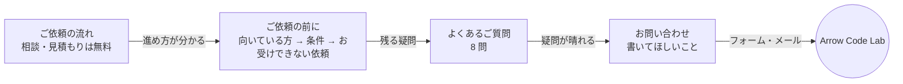
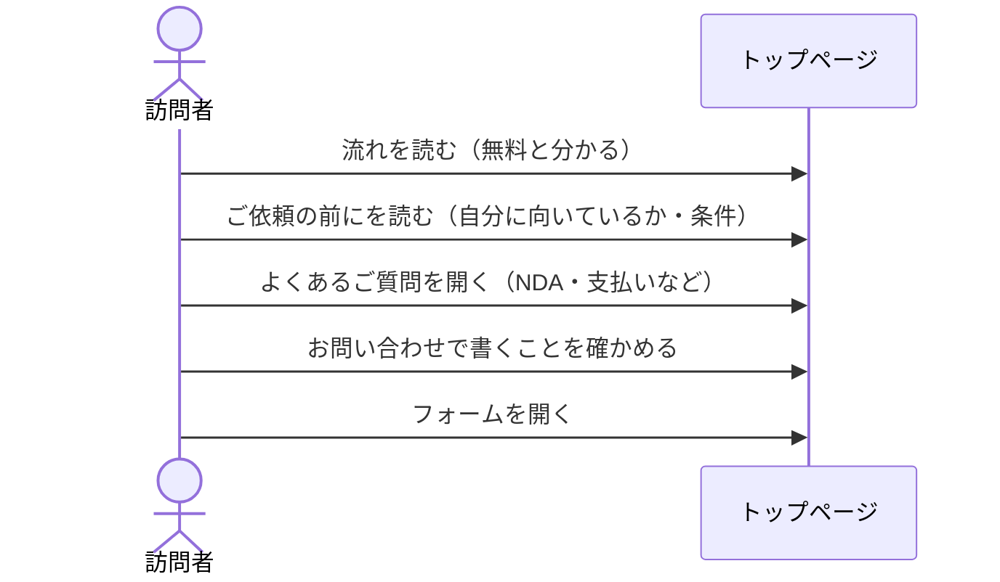
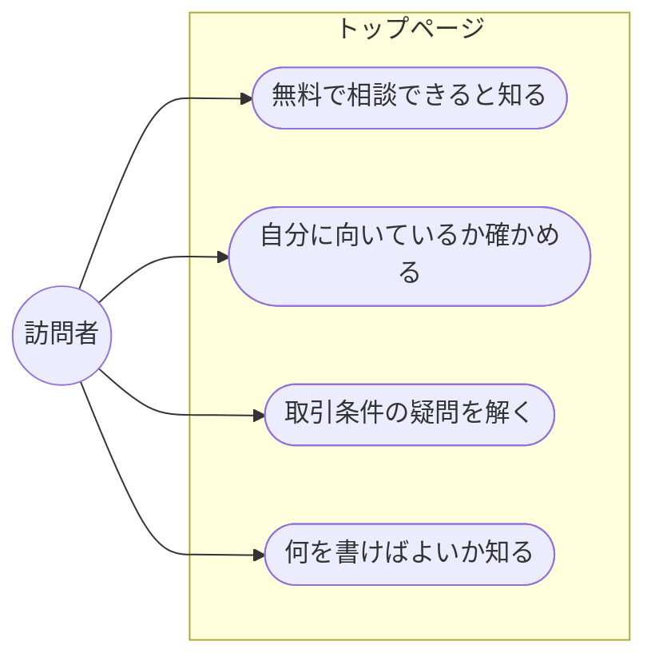
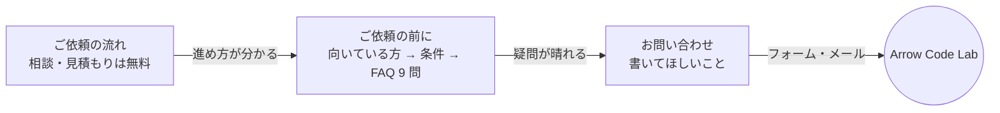
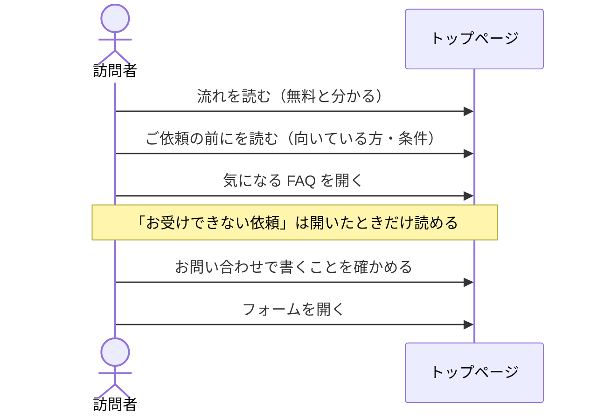
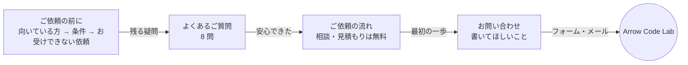
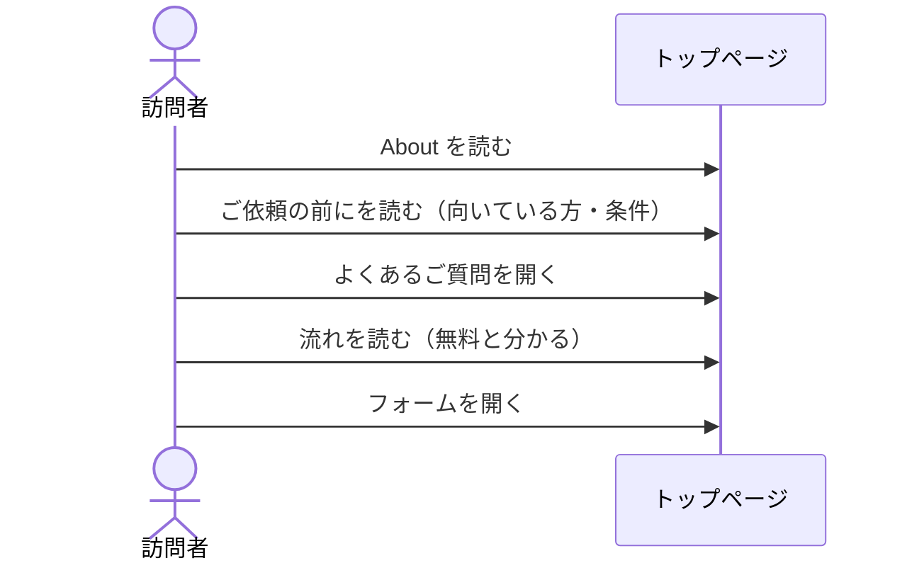

# 案: 安心して問い合わせられるようにする（Flow・Notice・FAQ・Contact）

<!-- draft:common:start -->
## 背景

トップページの問い合わせの直前に「お受けできないご依頼」が並んでいて、相談してよい内容の例や、問い合わせに何を書けばよいかの案内がない。訪れた人が「自分の依頼は断られるのでは」と感じて、問い合わせをやめてしまうおそれがある。

## ゴール

- 問い合わせの直前に、断る条件だけが並んでいない
- 取引条件の主な疑問（小さな依頼・NDA・権利・契約・支払い・遠方・納品後の修正と保守）が FAQ で解消できる
- 問い合わせに何を書けばよいかが分かり、要件が固まっていなくても相談してよいと伝わる
- 副業の条件（平日の夜と土日祝日・返信は 3 日以内・即時対応なし）と矛盾する約束がない

## 要件（全案共通）

- Flow に「ご相談・お見積もりは無料」を書く
- Notice を「こんな方に向いています」から始め、お受けできない依頼はその後に置く
- FAQ を追加する。載せる事実は問診で確かめた 8 つ（小さな依頼・相談のみ可／NDA／成果物の権利の譲渡／納品後の修正（即時対応は除く）／全国・オンライン対応／支払いは銀行振込／契約書を交わす／納品後の保守も相談可）
- Contact に、書いてほしいこと（やりたいこと・困りごと／今のやり方／希望の時期／ご予算の目安）と、要件が固まっていなくてよい旨を書く
- 英語ページ（EnHomePage）は変えない
<!-- draft:common:end -->

<!-- draft:A:start -->
## 案A: FAQ を問い合わせの直前に置く

#### 確認ページ
- 要約: 並びを「流れ → ご依頼の前に → よくあるご質問 → お問い合わせ」にする。断る条件のあとに FAQ をはさみ、問い合わせの直前は疑問が晴れる場所にする
- 得るもの: 問い合わせの直前で「小さな依頼でもよい」「NDA を結べる」などが読める。お受けできない依頼は Notice に残るので、条件は今と同じくはっきり伝わる
- 失うもの: セクションが 1 つ増え、ページが少し長くなる

対象画面: src/components/HomePage.astro
モック: .ai/work/5/mock-A.html

#### データフロー図
見てほしい点: 訪問者が読む順に、不安が減っていく並びになっているか

#### シーケンス図
見てほしい点: 問い合わせボタンの直前に読むものが FAQ になる

#### ユースケース図
見てほしい点: 訪問者ができることが増えているか

<!-- draft:A:end -->

<!-- draft:B:start -->
## 案B: 「ご依頼の前に」に FAQ をまとめる

#### 確認ページ
- 要約: セクションは増やさず、「ご依頼の前に」の中を「向いている方 → 条件 → よくあるご質問」にする。お受けできない依頼は FAQ の 1 問「お受けできない依頼はありますか？」に入れる
- 得るもの: セクション数が今と同じで、ページが長くならない。断る条件が一覧として目立たなくなる
- 失うもの: お受けできない依頼が開かないと見えない場所に入り、読まずに問い合わせる人が増えるおそれがある。CLAUDE.md の「Notice にお受けできない依頼を載せる」の書き方も変わる

対象画面: src/components/HomePage.astro
モック: .ai/work/5/mock-B.html

#### データフロー図
見てほしい点: 1 つのセクションの中で、条件から FAQ へ流れるか

#### シーケンス図
見てほしい点: お受けできない依頼は、FAQ を開いた人にだけ見える

#### ユースケース図
見てほしい点: 案A と同じことができるが、場所が 1 つにまとまる

<!-- draft:B:end -->

<!-- draft:C:start -->
## 案C: 流れを問い合わせの直前に置く

#### 確認ページ
- 要約: 並びを「ご依頼の前に → よくあるご質問 → ご依頼の流れ → お問い合わせ」にする。条件と疑問を先に済ませ、最後に「まずは無料のお問い合わせから」という流れを見せて問い合わせへつなぐ
- 得るもの: 問い合わせの直前が「01 お問い合わせ（無料）」から始まる手順になり、次にやることがはっきりする
- 失うもの: About の直後に条件と断る話が来るので、信頼を積んだ流れが途中で切れる。進め方を知る前に条件を読むことになる

対象画面: src/components/HomePage.astro
モック: .ai/work/5/mock-C.html

#### データフロー図
見てほしい点: 条件と疑問を先に読み、流れから問い合わせへ進むか

#### シーケンス図
見てほしい点: About を読んだ直後に条件を読む順番になる

#### ユースケース図
見てほしい点: 案A と同じことができ、読む順だけが違う

<!-- draft:C:end -->

<!-- draft:questions:start -->
### Q1: ヘッダーのメニューに「よくあるご質問」を足しますか？
- 足さない: 今のメニュー（サービス・開発事例・お問い合わせ）のまま。スマホでは今と同じく「お問い合わせ」だけが見える
- 足す: FAQ へ直接飛べる。メニューが 4 つになり、狭い画面では隠れる

### Q2: FAQ はどう見せますか？
- 開閉式: 質問だけを並べ、押すと答えが開く（モックの形）。8 問でも短く収まる
- すべて開いて並べる: 押さなくても全部読める。ページが長くなる

### Q3: Notice の「こんな方に向いています」の 4 項目（モックの文言）でよいですか？
- このままでよい: 要件が固まっていない方／小さく始めたい・相談だけの方／メール・チャットで進めたい方／納期に余裕のある方
- 直したい: その他に直したい点を書く
<!-- draft:questions:end -->
