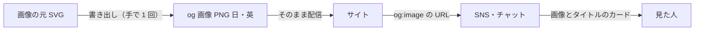
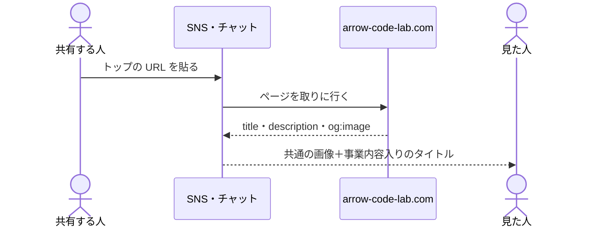
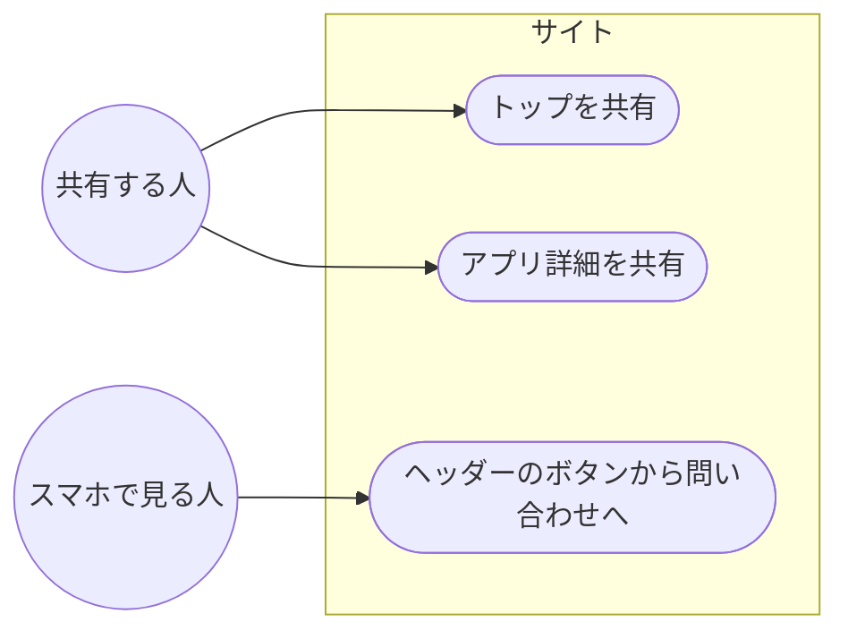
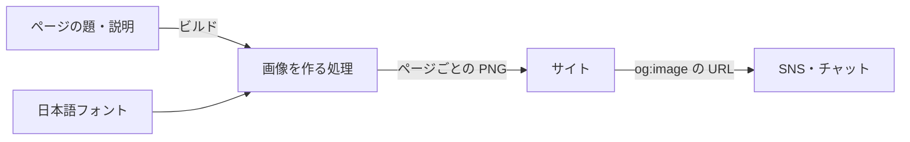
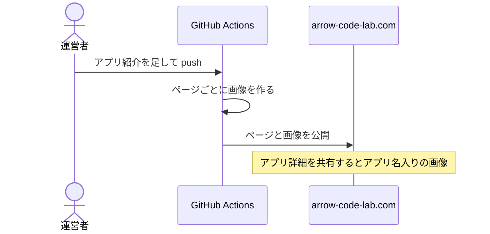
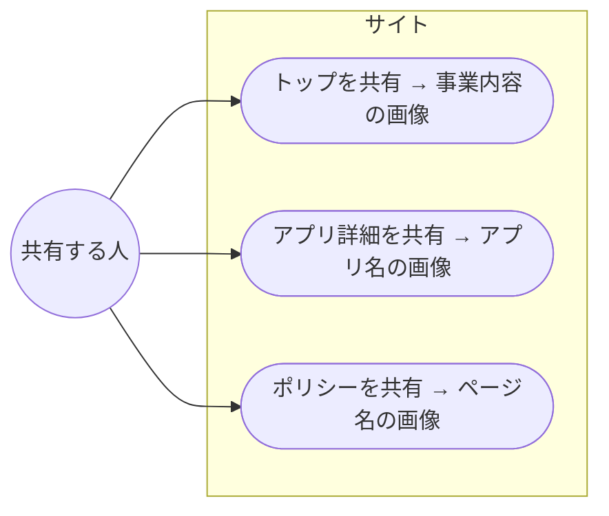
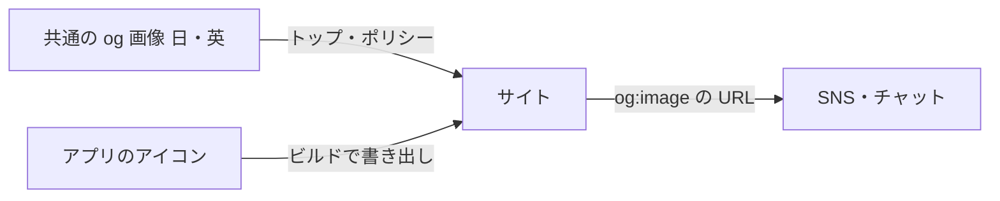
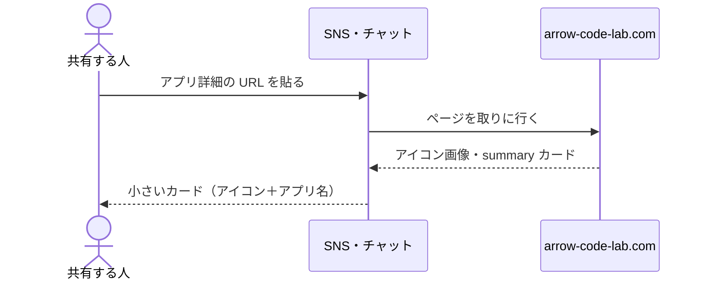
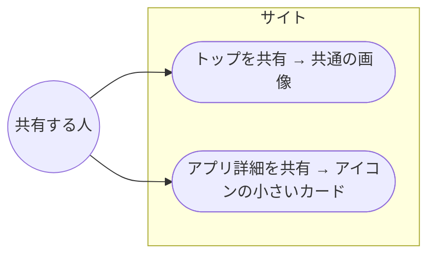

<!-- draft:common:start -->
## 背景と課題

リンクを SNS やチャットで共有しても画像が出ない（og:image が無い）。トップの title が「Arrow Code Lab」だけで、検索結果から何の事業かが分からない。スマホのヘッダーでは「お問い合わせ」がただの文字リンクで、ほかの文字と見分けにくい。

今の作り（`src/layouts/BaseLayout.astro`）:

- og:title・og:description・og:url は出ているが、og:image と twitter:card が無い
- トップは title を渡しておらず、`Arrow Code Lab` だけになる
- description は日本語・英語とも `src/i18n/ui.ts` の `site.description`（事業内容は入っている）
- ヘッダー（`src/components/Header.astro`）はスマホ幅でサービス・開発事例を隠し、お問い合わせと EN だけを文字で出す

## ゴール

- リンクを共有したときに、事業内容が分かる画像とタイトルが出る
- 検索結果のタイトルから事業内容が分かる
- スマホでお問い合わせへの導線がすぐ見つかる

## 要件

- og:image は 1200×630 の PNG。og:image の絶対 URL・幅・高さ・代替テキストと、`twitter:card` を出す
- トップの title に事業内容を入れる（下層ページは今の「{ページ名} | Arrow Code Lab」のまま）
- ヘッダーのお問い合わせを、塗りのボタンの見た目にする（スマホでも PC でも同じ）
- 英語ページには受託・AI相談の文言を出さない（画像も英語用は屋号とアプリ紹介だけ）
- 金額・個人名・副業の条件と矛盾する約束を画像にも書かない
<!-- draft:common:end -->

<!-- draft:A:start -->
## 案A: 全ページ共通の画像を 1 枚（日英 2 枚）用意する

#### 確認ページ
- 要約: 屋号・事業内容の一言・矢印のマークを載せた画像を、日本語用と英語用の 2 枚だけ作ってリポジトリに置く。全ページで同じ画像を使う。画像は SVG で書き、PNG に書き出したものを置く
- 得るもの: 依存パッケージが増えず、ビルドも変わらない。画像を目で確かめてから置ける。どのページを共有しても屋号と事業内容が伝わる
- 失うもの: アプリ詳細やポリシーを共有しても、画像はトップと同じで、ページの題は画像に出ない（タイトル文には出る）。画像の文言を変えるときは書き出し直しが要る

#### データフロー図
見てほしい点: 画像は 1 回作って置くだけで、ビルドの流れは変わらない

#### シーケンス図
見てほしい点: 共有した人は何もしなくてよい

#### ユースケース図
見てほしい点: どのページを共有しても同じ画像

対象画面: src/layouts/BaseLayout.astro, src/components/Header.astro
モック: .ai/work/6/mock-A.html
<!-- draft:A:end -->

<!-- draft:B:start -->
## 案B: ページごとの画像をビルドのときに作る

#### 確認ページ
- 要約: ビルドのときに、ページの題を入れた画像をページごとに作る（トップ・アプリ詳細・ポリシー類）。画像の作成には satori と sharp を使い、日本語フォントをリポジトリに置く
- 得るもの: アプリ詳細を共有すると、アプリ名入りの画像が出る。文言やアプリを足せば画像も自動で変わり、書き出し直しが要らない
- 失うもの: 依存パッケージが 2 つ増え、日本語フォント（数 MB）を置く。ビルドが重くなり、壊れたときに直す所が増える。ページが 10 枚に満たない今は手間に見合いにくい

#### データフロー図
見てほしい点: ビルドのたびに、ページの題から画像を作る

#### シーケンス図
見てほしい点: アプリを足すと、画像も一緒に増える

#### ユースケース図
見てほしい点: 共有したページごとに画像が違う

対象画面: src/layouts/BaseLayout.astro, src/components/Header.astro, 新規（画像を作るエンドポイント）
モック: .ai/work/6/mock-B.html
<!-- draft:B:end -->

<!-- draft:C:start -->
## 案C: 共通の画像＋アプリ詳細はアプリのアイコン

#### 確認ページ
- 要約: トップとポリシー類は案A の共通画像を使う。アプリ詳細だけは、アプリのアイコン（既にある 512×512）を画像にし、小さいカード（`twitter:card` を summary）で出す
- 得るもの: アプリ詳細を共有すると、そのアプリだと分かる（自社アプリの紹介に効く）。依存は増えない。アイコンはビルド時に既存の仕組みで書き出せる
- 失うもの: カードの形が 2 種類になり、出し分けが増える。アプリ詳細のカードは小さく、事業内容は伝わらない

#### データフロー図
見てほしい点: アプリ詳細だけ画像の出どころが違う

#### シーケンス図
見てほしい点: どのページかでカードの大きさが変わる

#### ユースケース図
見てほしい点: トップは共通画像、アプリはアイコン

対象画面: src/layouts/BaseLayout.astro, src/components/Header.astro, src/components/AppDetail.astro
モック: .ai/work/6/mock-C.html
<!-- draft:C:end -->

<!-- draft:questions:start -->
### Q1: トップの title はどれにしますか？
- 事業内容が先: 「アプリ開発・AI活用のご相談｜Arrow Code Lab」。検索結果で末尾が切れても事業内容が残る
- 屋号が先: 「Arrow Code Lab｜アプリ開発・AI活用のご相談」。屋号で探す人に見つけやすい
- キャッチコピー: 「業務の困りごとを、アプリとAIで解決します｜Arrow Code Lab」。Hero と同じ言葉で、長めになる

### Q2: ヘッダーのお問い合わせボタンの行き先はどこにしますか？
- ページ内のお問い合わせ: 今と同じ。返信の目安や書いてほしいことを読んでからフォームへ進む
- Google フォームを直接開く: Hero の主ボタンと同じ。1 回少なく押せるが、対応条件を読まずに送れる

### Q3: 英語ページはどうしますか？
- 英語用の画像と title を用意: 屋号とアプリ紹介の言葉だけの画像にする。title は「Arrow Code Lab — Apps for everyday needs」の形
- 画像だけ英語用にする: title は今の「Arrow Code Lab」のまま
<!-- draft:questions:end -->
